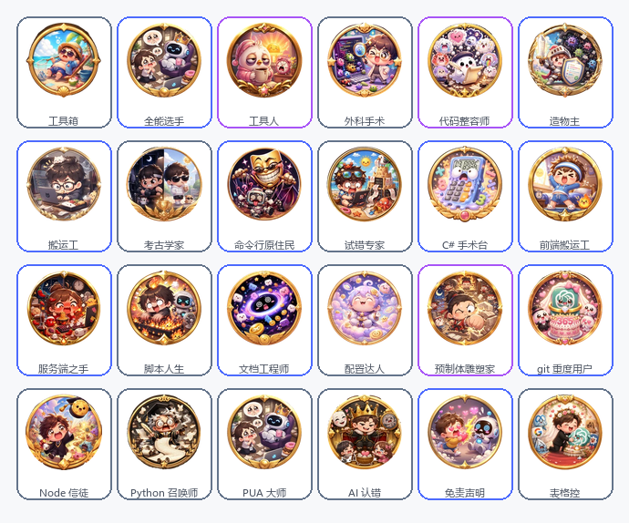

# CodeQuest for DSH

把 DeepSeek Harness 真实的 **Token 流量 / 会话内容 / 工具调用** 变成一款成就游戏，并可连接自建服务器参与排行榜。

灵感与成就文案来自 [`MrLukezy/ai-using-achievement`](https://github.com/MrLukezy/ai-using-achievement)（TokenMonitor · CodeQuest），本插件是为 DSH 重新实现的数据层与界面，不是原项目的移植。

## 安装

```bash
git clone https://github.com/MrLukezy/dsh-codequest.git
```

然后在 DSH 里把它装成 bundle（路径指向仓库根目录）：

```
plugin_manager { action: "install_bundle", target: "<绝对路径>/dsh-codequest" }
```

装好后插件行 id 是 `include:dsh-codequest`；改完 Host 代码用 disable → enable 重载，改完 Client 代码刷新页面。排行榜是可选功能，不配置也能单机玩。

## 仓库结构

```
dsh-codequest/            ← 插件包根目录（DSH 直接安装这一层）
├─ index.js               Host 半区：扫描会话、算成就、HTTP 路由、免密登录签名
├─ client.js              Client 半区：CodeQuest 页 + 浮层 HUD + 解锁提示
├─ scan.js / text.js      会话日志折叠与文本信号提取
├─ achievements.js        99 枚成就定义与等级曲线
├─ art.js                 成就 → 徽章图映射
├─ cloud.js               排行榜服务端客户端
├─ assets/icons/*.webp    84 张 chibi 徽章（192px）
├─ locale/                插件管理页的标题与描述
└─ server/                ← 排行榜服务端（Express + SQLite），可选
   ├─ server.mjs
   └─ package.json
```

## 它长什么样

在会话视图的标签栏里多出一个 **CodeQuest** 页，包含四个分区：

| 分区 | 内容 |
| --- | --- |
| 成就 | 99 枚成就，按 8 个分类**分组展示**（每组带 `已解锁/总数` 与积分进度条），每枚配 chibi 徽章图、稀有度描边与进度条；**点击卡片弹出详情**（达成条件、当前值/目标值、百分比、还差多少、解锁时间） |
| 数据 | 最近 30 天流量柱图、常用工具排行、24 小时时段分布、**文本性格**、情绪关键词、常改文件类型、常用命令、模型分布 |
| 排行榜 | 云端账号的成就数排行（前 50，带头像） |
| 账号 | **DeepSeek 账号一键登录**、同步、退出、服务器地址配置（邮箱密码作为备用入口） |

顶部是等级徽章、称号、积分与升级进度条。

### 会话页悬浮层

两个常驻组件注册在 `shell.overlay`（框架级浮层，点击穿透，只在自己绘制的区域接管指针）：

- **使用曲线 HUD**（右下角）：默认收成小胶囊（等级头像 + `Lv.x` + 今日 Token + 迷你折线），点它展开成完整卡片（近 14 天折线、解锁数、升级进度）；点 `−` 收回、点 `✕` 彻底隐藏，状态记在 `localStorage`，也可在「数据」页的「悬浮窗」开关里重新打开。
- **解锁提示**：成就解锁时右下角弹出 toast（徽章 + 名称 + 积分），6 秒自动消失，点击可立即关闭；最多同时 4 条。
- 首次加载会以当前解锁集合为基线，**不会把历史成就一次性弹出来**；之后新解锁的才提示。
- 样式表在插件加载时注入 `<head>`（`#dsh-codequest-style`），因为浮层不在 Conversation 视图的 DOM 树里，视图内联的样式管不到它；模块重载时会替换旧样式表而不是沿用缓存。
- 浮层整体 `pointer-events:none`，只有胶囊/卡片自身接管点击，不会挡住下面的界面。

## 数据来源

全部来自 DSH 自己的会话日志（`ctx.sessionQuery`），**不读任何第三方工具的数据，不上传会话正文**：

- `assistant/message.data.usage` → input / output / cacheRead / cacheWrite / reasoning / total tokens
- `assistant/message.data.message.source` 与 `request/header` → 模型、供应商
- `tool/call`、`tool/result` → 工具调用次数、工具种类、报错次数
- `user/message` → **只有 `data.source.kind === 'user'` 才算真人输入**；AGENTS.md、skill 目录、时间快照等注入内容全部排除
- 真人 prompt 与 AI 回复的文本信号（见下节），只存计数不存正文
- `turn/start`、`step/start`、事件 `time` → 轮次、时段、活跃天数、连续天数
- `SessionHeader.cwd` → 工作目录数量

## 文本信号

文本层（`text.js`）把每条 prompt 和每条 AI 回复压缩成布尔信号，`state.json` 里只有计数器：

| 来源 | 信号 |
| --- | --- |
| 你的 prompt | 疑问 / 极短指令 / 长文需求 / 重试纠正 / 质疑 / 礼貌 / 表情 / 追问原理 / 暴躁 / emo / 咖啡 / 周末摸鱼 / 报错堆栈 / 贴代码 / 中英混用 / 夸奖 / 道歉 |
| 业务词 | 服务端 / git 分支 / 需求策划 / 美术 UI / 性能 / 发布 / Unity / 测试 / 重构 |
| AI 回复 | 代码块语言分布、表格、列表、道歉、含糊措辞、TODO、emoji、超长回复 |
| 工具参数 | 触碰的文件扩展名（.cs/.js/.java/.py/.json/.md/.prefab…）、命令首词（git/node/python/ssh…） |

拉丁关键词按词边界匹配（`ui` 不会命中 build），中文关键词用短语而非单字（`滚` 不会命中「滚动」）。

每个会话被折叠成一份紧凑摘要（不含完整正文），缓存在：

```
$DSH_HOME/storages/dsh-codequest/state.json
```

折叠口径变化时 `scan.js` 里的 `FOLD_VERSION` 需要 +1，旧缓存会被重建。

## 成就与等级

- 99 枚成就，稀有度 `common / rare / epic / legendary`，分值 5–45。
- 分类：Token 流量 10 / 交互 9 / 时间 6 / 文本性格 14 / 职场 12 / 代码与工具 22 / 精通 9 / 彩蛋 17。
- 阈值按本机真实数据分布标定：既有当前就能拿到的，也有需要长期积累的。
- 隐藏成就（`daily_100m`、`midnight_tokens_10m`）未解锁前显示 `???`。
- 等级公式：每级所需积分按 1.35 倍递增，起始 40 分；称号从「新手观察员」到「Token 之神」。
- 判定是**单调**的：解锁时间一旦写入不会被撤销。

新增成就只需在 `achievements.js` 的 `ACHIEVEMENTS` 里加一条：

```js
{
  id: 'my_achievement', name: '名字', desc: '风味文案', cond: '达成条件说明',
  icon: '🎯', rarity: 'rare', points: 12, category: 'code',
  target: 100, metric: (m) => m.toolCalls,
}
```

`m` 是 `scan.js` 的 `aggregate()` 输出（见该文件末尾返回对象），因此新成就通常不需要改采集层。

新成就还要在 `art.js` 里补一行 `'my_achievement': '<徽章名>'`，否则卡片只会显示 emoji 兜底。

## 美术资源



- 徽章来自 `MrLukezy/ai-using-achievement` 的 chibi 成就图（MIT），已裁掉透明边、居中方形化并缩到 192px WebP，共 84 张，合计约 1.5 MB。
- 映射表在 `art.js`（99 条成就 → 84 张徽章，一一对应，无遗漏）；重复使用的徽章只出现在语义相近的成就上。
- 文件放在 `assets/icons/<name>.webp`，由 Host 的 prefix 路由 `GET /dsh-codequest/icon/<name>.webp` 以 `image/webp` + `immutable` 缓存下发；只接受 `[a-z0-9_]+\.webp`，路径穿越直接 404。
- 插件图标 `icon.png` 由 `syn_ai_grandmaster` 徽章 + 品牌渐变合成。
- 卡片按稀有度着色：`common` 灰蓝、`rare` 蓝、`epic` 紫、`legendary` 琥珀；解锁态有描边与光晕，未解锁只降透明度并加 🔒，不再整卡去色。
- 顶部头像随等级换图（每两级一张），等级徽标叠在头像右下角。

## 云端排行榜

服务端在 `server/`，Express + better-sqlite3，单文件、无外部依赖服务。作者自用的实例部署在：

- API：`http://your-host.example/codequest/api`
- 管理后台：`http://your-host.example/codequest/admin/`
- 进程：systemd `codequest`（`127.0.0.1:3010`），nginx 以 `/codequest/` 反代

### 自己部署

```bash
cd server
npm install
DSH_SHARED_SECRET="$(openssl rand -hex 24)" JWT_SECRET="$(openssl rand -hex 32)" \
  ADMIN_PASS="换成你的密码" PORT=3010 BASE_PATH=/codequest node server.mjs
```

| 环境变量 | 说明 |
| --- | --- |
| `PORT` | 监听端口，默认 `3010` |
| `BASE_PATH` | 反向代理前缀，默认 `/codequest`；服务挂在 `${BASE_PATH}/api` |
| `JWT_SECRET` | 会话 token 的签名密钥，务必自己生成 |
| `ADMIN_USER` / `ADMIN_PASS` | `/admin` 后台账号，默认 `admin` / 占位密码，**必须改** |
| `DSH_SHARED_SECRET` | 与插件共享的免密登录密钥；留空则关闭 `/auth/dsh` |

然后把插件「账号 → 服务器地址」改成你的 `${BASE_PATH}/api`，把同一个 `DSH_SHARED_SECRET` 填到「共享密钥」里（也可以直接 `POST /dsh-codequest/config {"sharedSecret":"…"}`）。

### 接口

插件默认用 **DeepSeek 账号免密登录**，邮箱密码只是备用入口：

| 接口 | 用途 |
| --- | --- |
| `POST /auth/dsh` | DeepSeek 账号免密登录：`{accountKey, contact, name, avatarUrl, signature}`，首次自动建号，之后按 `dsh_account_id` 命中同一账号 |
| `POST /auth/register`、`POST /auth/login` | 邮箱密码注册 / 登录（备用） |
| `POST /sync/achievements` | 上传解锁记录 `{id, unlockedAt}` |
| `POST /sync/season` | 建立/读取赛季起点 |
| `POST /sync/progress` | 上传 `{totalTokens, totalSessions, sentiment, sources}`（服务端按字段取 MAX） |
| `GET /leaderboard/achievements?limit=50` | 成就数排行榜 |

免密登录的身份来自 Host 的 `ctx.deepseekAccount`（`getState()` + `getProfile()`），取 `profile.id` 作为稳定账号键、`profile.name` 作为昵称、`profile.avatarUrl` 作为头像；`contact` 若是脱敏手机号则不会写成邮箱。Host 用共享密钥对 `accountKey|contact` 做 HMAC-SHA256，服务端用 `crypto.timingSafeEqual` 校验，因此伪造的身份会被拒绝（401 `bad_signature`）。

**共享密钥不写死在仓库里**：插件侧通过 `state.json` 的 `cloud.sharedSecret`（界面「账号 → 共享密钥」或 `POST /dsh-codequest/config`）设置，服务端侧用环境变量 `DSH_SHARED_SECRET`，两处一致即可。仓库里的默认值 `change-me-codequest-shared-secret` 只是占位符，正式部署必须换掉。

服务器地址可在界面「账号 → 服务器地址」里改，也保存在 `state.json` 的 `cloud.base`。

## Host 路由

同源 JSON 接口（同时注册 `/dsh-codequest/*` 与 `/dsh/dsh-codequest/*`，以适配根路径与 `/dsh/` 前缀两种部署）：

| 方法 | 路径 | 说明 |
| --- | --- | --- |
| GET | `/dsh-codequest/state` | 全量状态（统计 + 成就 + 进度 + 云端信息），超过 20s 未扫描会触发一次后台扫描 |
| GET | `/dsh-codequest/account` | 读取本机已登录的 DeepSeek 身份（供账号页展示） |
| POST | `/dsh-codequest/cloud/dsh-login` | 用 DeepSeek 身份免密登录排行榜 |
| POST | `/dsh-codequest/refresh` | 触发扫描，`{force:true}` 强制重建全部折叠 |
| POST | `/dsh-codequest/config` | 修改 `{cloudBase, sharedSecret}` |
| POST | `/dsh-codequest/cloud/login` / `register` / `logout` | 账号操作 |
| POST | `/dsh-codequest/cloud/sync` | 推送成就与进度 |
| POST | `/dsh-codequest/cloud/leaderboard` | 拉取排行榜 |
| GET | `/dsh-codequest/icon/<name>.webp` | 成就徽章静态图（prefix 路由，7 天 immutable 缓存） |

写操作校验 `Origin` 与 `Host` 同源；路由不参与 DSH 的登录网关，公网部署时请把 `/dsh-codequest/` 一并放在网关之后。

## 测试

测试不依赖运行中的 Harness，直接跑：

```powershell
# 采集 + 成就 + HTTP 路由全链路（读本机真实会话日志）
node test/host.test.mjs "$env:DSH_HOME\sessions"

# 折叠与聚合口径
node test/fold.test.mjs "$env:DSH_HOME\sessions"

# 浏览器半区：模块加载 + slot 注册（用桩 React）
node test/client.test.mjs

# 组件渲染：用真实 /state 数据跑分组与成就墙，崩溃即标签页白屏
node test/render.test.mjs
```

前两个需要本机存在 DSH 会话日志；后两个不需要，可单独跑。

## 已知限制

- 首次扫描需要遍历全部历史会话（本机 109 个会话约 2–4 秒），之后只重扫活跃会话。
- 情感与文本信号只看**真人** prompt；注入上下文（AGENTS.md、skill 目录、时间快照）已排除，因此 `promptChars` 只统计你真正打的字。
- 每类信号每个 prompt 只计一次，且只看会话前 12 条 prompt 的前 600 字符。
- 「夜间」定义为 20:00 之后开始；「周末」类成就已移除（对工作日作息不可达成）。
- 礼貌 / emoji / 咖啡这类信号取决于你的表达习惯，可能长期为 0——它们是彩蛋，不是必拿项。
- 排行榜只统计成就数，不区分成就分值。
- 界面文字目前中/英双语硬编码在 `client.js`，`locale/*.json` 只提供插件管理页的标题与描述。